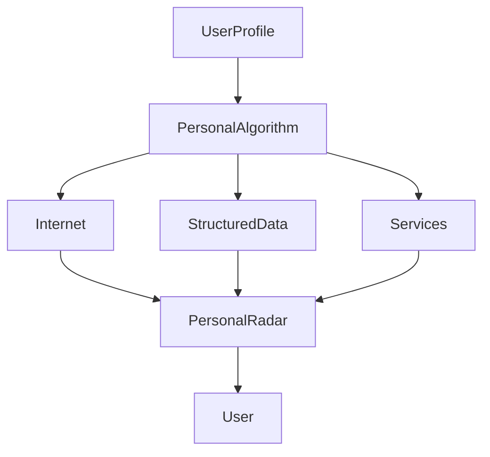
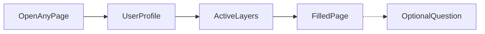
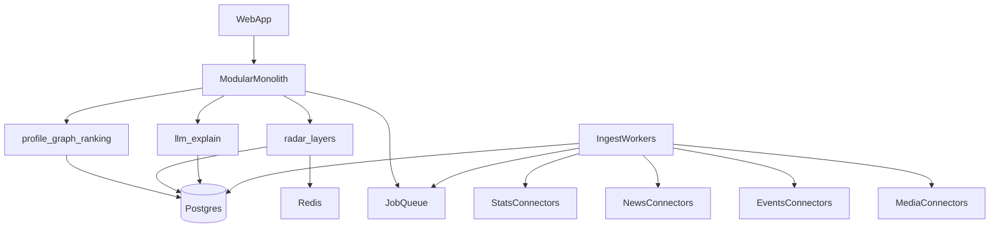

# FRIDAY: план проекта по фичам

**Продукт:** глобальная персональная информационная площадка. Пользователь один раз говорит, кто он и что ему важно. Система сама собирает данные и **сама кладёт их на стол** на тех страницах, которые этому человеку вообще нужны. Спрашивать не нужно.

Это не продукт про карьеру, не продукт про одну профессию и не продукт про одну страну. Карьера, новости, календарь, знания, развлечения — равные слои. Какие из них загораются, решает профиль.

**Не делаем:** «Inoreader красивее + LLM», чат как главный интерфейс, корпоративный алгоритм вместо пользовательского, и клинья вида «сначала только SDET / только рынок труда / только США».

Оценка компании и exit-сценарии в этот план не входят.

---

## Принцип продукта

Пользователь владеет профилем и алгоритмом. Система не спрашивает «какие RSS ты хочешь читать?». Онбординг спрашивает «кто ты и чего хочешь?» — один раз. После этого площадка **собирает его мир** и пушит готовую картину на нужные страницы.

Два разных человека получают две разные площадки из одного продукта:

- у одного горят календарь игр, стримы и новости по AI
- у другого — экономфорумы, рыночная стата и компании
- у третьего — работа, зарплаты и отраслевые конфы

Если в профиле нет карьерной цели, слоя Work на площадке нет. Он не «главный экран, который мы ещё не заполнили».

Главный жест: зашёл на страницу → данные уже там. Вопросы — уточнение поверх уже увиденного.

Ценность не в LLM. Ценность в цепочке: источники → сбор → нормализация → entity resolution → временные ряды → профиль → ranking → аналитика → страница, которая уже заполнена.

---

## Модель взаимодействия: страница первая, вопрос второй

Пользователь не ведёт продукт вопросами. Профиль сам решает, какие слои существуют и что на них рисовать.

- Открыл `/` (Radar) — сразу секции его мира: что важно сегодня по всем активным слоям.
- Открыл `/calendar` — сразу лента и сетка дат по интересам: релизы, конференции, форумы. Не пустой Google Calendar.
- Открыл `/news` — сразу события из его графа.
- Открыл `/knowledge` — сразу материалы по его темам и технологиям.
- Открыл `/work` — только если в профиле есть профессия / карьерная цель: графики рынка, ЗП, вакансии.
- Спросил что-то по карточке или графику — только если хочет копнуть глубже.

Нет пустой страницы с поиском. Нет «задайте вопрос, чтобы увидеть мир». Нет обязательного карьерного дашборда у всех.

---

## Слои продукта

Слои равны. Страница появляется, если профиль её активировал. Иначе её нет в навигации.

- **Radar** — домашняя сборка активного мира
- **News** — события по интересам, людям, компаниям, местам
- **Calendar** — будущие события из интересов: релизы, конференции, форумы, патчи, запуски
- **Knowledge** — исследования, репозитории, инструменты, длинные материалы
- **Work** — рынок труда, ЗП, вакансии, навыки; только при карьерной цели или профессии
- **Market** — структурированная стата по тому, что человек трекает: профессии, отрасли, экономика, что угодно, для чего есть ряды
- **Companies** — релизы, найм, руководство компаний из его графа
- **Entertainment** — YouTube, Twitch, игры, креаторы
- **Alerts** — то, что нельзя пропустить, поверх уже существующих страниц

Ни один слой не является центром продукта. News — не «главная лента». Work — не «первая версия FRIDAY».

---

## Ядро: сущности и алгоритм

Это строится раньше красивых лент. Без этого продукт снова станет агрегатором или очередным карьерным сайтом.

### Профиль пользователя

Пользователь задаёт один раз и потом крутит веса. Поля не обязаны быть про работу:

- кто он: роль, если есть; возраст; образование — по желанию
- где живёт / какие страны и города ему важны
- цели: деньги, работа, учёба, развлечения, здоровье, своё
- интересы со шкалой 1–10
- компании, люди, креаторы, технологии, игры, локации, которые он явно добавил

Система из профиля **выводит** сущности и слои, которые он не перечислял вручную: связанные темы, типы календаря, источники статы, компании, людей. Если указана профессия — в том числе рынок труда. Если указаны игры — в том числе релизы. Если экономика — форумы и макродаты.

### Активация слоёв

Правило одно на всю площадку: слой жив, только если в графе есть узлы, которые его кормят.

- интерес Gaming / конкретные игры → Calendar (релизы) + Entertainment
- интерес Economics → Calendar (форумы, решения ЦБ) + Market + News
- интерес AI / технологии → Knowledge + Calendar (конференции) + News
- профессия или цель «работа / доход» → Work + связанный Market
- указанные креаторы → Entertainment
- указанные компании → Companies + их события в Calendar и News

Пользователь может принудительно выключить слой, даже если профиль его активировал.

### Personal Data Graph

Узлы вокруг пользователя:

- `User`, `Goal`, `Interest`
- `Profession`, `Skill` — если есть
- `Company`, `Person`, `Creator`, `Technology`, `Game`, `Location`
- сигналы: `News`, `Statistic`, `Event`, `Video`, `Stream`, `Repo`, `Paper`, `Job`, `Salary`
- типы `Event`: `Conference`, `Forum`, `Release`, `Patch`, `Launch`, `Earnings`, `Meetup`, `Talk`

Связи несут вес, время и источник: `interested_in`, `follows`, `lives_in`, `works_as`, `plays`, `mentions`.

### Personal Algorithm — то, чем пользователь реально управляет

Не чёрный ящик Discover. Отдельный экран «How FRIDAY thinks about me»:

- веса интересов
- веса слоёв: пользователь сам решает, что для него центр, а что фон
- mute / boost по сущностям, темам и типам календаря
- «больше такого / меньше такого» на любой карточке
- explainer на каждой карточке: *почему это тебе показано*
- можно отключить источник, тип данных или слой целиком

Это и есть дифференциация против Google Discover: алгоритм принадлежит пользователю.

### Персональный календарь — не Google Calendar

Это не планировщик встреч. Это **календарь мира относительно человека**: что скоро случится в тех областях, которые он отметил.

Профиль сам подписывает дорожки. Пользователь их не собирает вручную из RSS.

- игры → релизы, крупные патчи, сезоны, ивенты
- экономика / финансы → форумы и решения: Davos, Jackson Hole, FOMC, G20, отчётность компаний из графа
- технологии / AI / любая предметная область → конференции, launch-окна, talks
- профессия, если есть → отраслевые даты
- компании из графа → их релизы и earnings

Один экран `/calendar`, внутри — дорожки по интересам. Открыл страницу — сетка уже заполнена. На Radar сверху — полоска «ближайшие 7 / 30 дней».

Правила:

- событие попадает в календарь только если связано с узлом профиля
- вес интереса влияет на то, насколько событие торчит
- mute дорожки целиком или одного события
- explainer на событии: *показано, потому что этот интерес у тебя 9/10*
- не превращаемся в личный scheduler: дни рождения, стоматолог, рабочие митинги — вне продукта

---

## Архитектура: модульный монолит, не микросервисы

**Решение: один модульный монолит + фоновые воркеры.** Микросервисы с первого дня не делаем.

Продукт выглядит как много систем (стата, новости, календарь, медиа, LLM). На деле до product-market fit это **одна система с жёсткими внутренними границами**. Микросервисы здесь дают распределённые падения и месяцы на обвязку — и не дают быстрее собрать персональный мир.

Что именно строим:

**Монолит отвечает на запрос пользователя.** Открыл страницу — API читает уже собранные сигналы и ряды. Никакого «сейчас сходим в 8 сервисов».

**Воркеры отдельно по процессу, не по репозиторию.** Сбор источников — джобы в очереди. Падение коннектора не роняет сайт.

**Коннекторы — плагины с одним контрактом**, не сервисы. Каждый источник: fetch → normalize → entity resolve → записать сигнал/ряд. Новый источник = новый модуль в том же репо. BLS, job-борды, YouTube, конференц-календари — адаптеры одного и того же контракта, не отдельные продукты.

**Данные в одной Postgres**, пока хватает. Профиль, граф, сигналы, события, time series как обычные таблицы (+ JSONB там, где схема источника ещё плывёт). Redis: кэш страниц и очередь, не source of truth.

**LLM — модуль объяснения, не ядро.** Вызывается после того, как данные уже лежат в БД.

Внутренние модули:

- `profile` — кто пользователь и веса алгоритма
- `graph` — сущности, связи, активация слоёв
- `ingest` — коннекторы и нормализация
- `series` — агрегаты во времени
- `ranking` — что попадает на страницу
- `pages` — Radar и слои
- `explain` — текст «что это значит для тебя»

Когда всё-таки резать (не раньше живых слоёв и реальной нагрузки):

- воркеры ingest уже отдельным процессом с дня один — это фон, не микросервисы
- вынести ingest, если коннекторы душат API
- вынести explain, если LLM диктует релизный цикл
- не делать сервис-на-источник и сервис-на-слой

Стек на старте не догма, но должен быть скучным: один backend, один фронт, Postgres, очередь, Redis. Конкретные фреймворки выбираем в момент сборки.

---

## Фазы

### Phase 0 — Foundation

Цель: любой человек создаёт профиль и видит каркас *своего* мира — не карьерный кабинет.

- аккаунт и онбординг: кто он, где, цели, интересы с весами, сущности которые уже знает
- редактор профиля и сущностей
- экран алгоритма: веса слоёв, mute/boost
- правила активации слоёв
- каркас Personal Graph в БД
- домашняя **Radar** и скелеты всех слоёв; в навигации только активные
- карточка сигнала / графика с обязательным «почему тебе»

Без профиля не подключаем источники. Страницы сразу выглядят как дашборды, а не как чат.

### Phase 1 — Живая площадка из профиля

Цель: два разных профиля дают два разных Radar. Это и есть первый продукт — не одна «главная» страница про работу.

Страницы сами наполняются по активным слоям. На старте достаточно доказать паттерн на нескольких типах данных сразу, а не углубить один вертикальный рынок:

- **News** — события по интересам и сущностям
- **Calendar** — ближайшие даты по тем же интересам
- **Market / stats** — ряды и графики там, где для сущности есть публичная стата
- **Work** — только если профиль его включил: рынок, ЗП, вакансии как *один из* блоков, не центр
- **Entertainment** — хотя бы список того, за чем человек следит; живые фиды можно тоньше

Связывающий инсайт тоже проактивный и не обязан быть про работу. Система сама склеивает сигналы из разных слоёв, если они про одну сущность в графе.

Источники Phase 1: несколько легальных коннекторов разных типов (новости / события / стата). Исторические ряды копим с первого дня — без них графики пустые. Ни один источник не становится «якорным продуктом».

### Phase 2 — Уточнение уже увиденного

Надстройка над любой страницей, не вход в продукт.

Человек кликает график, карточку, событие календаря и уточняет. Система отвечает из уже лежащих в графе слоёв. Если данных не хватает — сама ставит задачу на досбор и обновляет блок, когда данные приедут.

Чат на весь продукт не появляется.

### Phase 3 — Глубина слоёв

Наращиваем источники и плотность там, где граф уже просит данных — не «добавляем карьеру как следующий продукт».

- Knowledge: репозитории, инструменты, papers по темам профиля
- Companies: то, что происходит с компаниями из графа
- Work: если слой активен — больше разрезов рынка, вакансии, навыки
- News: больше источников, но всё ещё только сущности графа
- локальные источники под страну и язык пользователя

### Phase 4 — Calendar и Entertainment как ежедневный полюс

Чтобы заходили не раз в неделю «посмотреть цифры», а жили на площадке.

- полный календарь: лента 7 / 30 / 90 дней и месячная сетка, дорожки по интересам
- YouTube: новые видео с указанных каналов + редкие релевантные вне подписок
- Twitch: кто из его людей сейчас стримит
- игры: патчи и ивенты рядом с календарём релизов, не вместо него

Слои не смешиваются в одну кашу. У каждого свой вес, любой можно поставить в 0.

### Phase 5 — Alerts

- утренний briefing из всех активных слоёв
- пороги: скачок статы, событие календаря через N дней, новый выпуск у креатора, аномалия в любом трекаемом ряде
- digest на email / push только после того, как Radar уже полезен без уведомлений

### Phase 6 — Ширина площадки

Не «вторая профессия после первой», а больше мира на том же движке:

- новые страны и локальные источники (свои датасеты, не копия одного национального бюро)
- больше коннекторов статы, новостей, событий, медиа
- Telegram / Reddit / и другие каналы как коннекторы: **подключает система по профилю**, пользователь подтверждает или мьютит
- пользовательские сущности сверх шаблона
- экспорт профиля и алгоритма

---

## Фичи по приоритету

**P0 — без этого нет площадки**

- онбординг профиля и веса интересов
- активация слоёв из профиля
- Radar, который открывается уже заполненным *этим* миром
- explainer «почему этот блок тебе»
- экран управления алгоритмом

**P1 — мир начинает быть плотным**

- живые News и Calendar по графу
- графики и стата по сущностям, для которых есть ряды
- Work как обычный слой, если профиль его включил
- проактивные склейки между слоями
- вопрос к уже показанному блоку

**P2 — ежедневная площадка**

- Knowledge и Companies
- YouTube / Twitch
- briefing и алерты
- «больше / меньше такого» на любой карточке

**P3 — ширина**

- новые страны, языки, коннекторы
- сущности сверх шаблона
- opt-in на источники
- экспорт профиля и алгоритма

---

## Что сознательно не делаем в v1

- продукт «для одной профессии» или «сначала только карьера»
- универсальный RSS-reader и ручное дерево папок как в Inoreader
- чат как главный интерфейс
- скрейпинг закрытых сайтов
- соцсеть, комментарии, репосты
- личный планировщик встреч
- микросервисы и отдельный сервис на каждый источник или слой
- оценка стоимости компании — вне этого плана

---

## Как понять, что фаза готова

Не «фича есть», а «два разных человека узнают свой мир, а не чужой».

- **Phase 0 готова**, если в навигации у человека только его слои, а не полный каталог продукта.
- **Phase 1 готова**, если два профиля с разными интересами открывают Radar и за минуту видят разную картину — без единого вопроса и без обязательной страницы работы.
- **Phase 2 готова**, если уточнение к уже лежащему блоку отвечает данными из нескольких слоёв. Без вопроса страница всё равно полная.
- **Phase 4 готова**, если календарь и развлечения собираются из интересов сами и не заливают остальные слои.

---

## Порядок работ

Один репозиторий, модульный монолит, воркеры на ingest.

Первым делом — **профиль, граф, активация слоёв, Radar**. Не карьерный дашборд, не чат, не микросервисы. Дальше наполняем несколько слоёв параллельно достаточно, чтобы площадка ощущалась как чей-то мир, а не как вертикаль.

Разбивка первого куска на инженерные задачи: [TASKS.md](TASKS.md).
