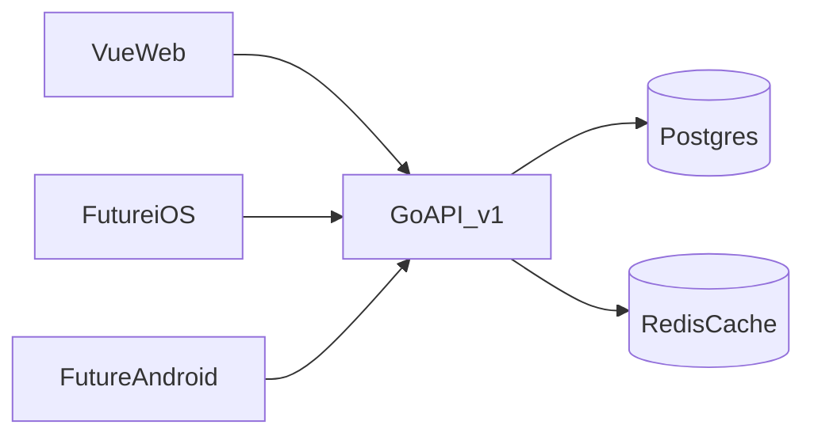

# Phase 0: задачи на движок мира

Первый кусок из [PLAN.md](PLAN.md): профиль, граф, активация слоёв, Radar. Источники, живые новости и календарь — следующий этап.

---

## Стек

Зафиксировано:

- **Go** — модульный монолит, JSON API `/v1`
- **Vue 3** + Vite + Vue Router + Pinia — только веб-клиент
- **Postgres** — source of truth
- **Redis** — кэш собранного «мира» пользователя (`GET /v1/me/radar`), не очередь и не сессии

Дополнительно (нужно сразу):

- **Docker Compose** — Postgres + Redis локально
- **golang-migrate** — миграции
- **pgx** — драйвер Postgres
- **chi** — HTTP-роутер, простой и предсказуемый для мобильных клиентов
- **OpenAPI 3** — контракт API. Веб и будущие iOS/Android едят один документ
- **JWT access + refresh** — один и тот же auth для веба и приложений. Не cookie-only сессии
- **Tailwind** — mobile-first утилиты, база 375px

Позже, не в этом наборе задач:

- очередь на Redis (**asynq**) и воркеры ingest — когда появятся коннекторы
- нативные клиенты iOS/Android — отдельный репозиторий или папки, тот же `/v1`

---

## Как держим мобилки в голове, делая веб

- Вся бизнес-логика в Go. Vue ничего не «решает» про слои — только рисует ответ API.
- Экраны = API-ресурсы: онбординг, профиль, алгоритм, radar. Приложения потом повторяют те же экраны.
- Вёрстка от узкого экрана: нижняя навигация на мобиле, боковая от `md` и выше.
- Карточки и дашборды не завязаны на hover и широкую сетку.
- Никакого SSR и HTML с сервера: один JSON, три клиента.

---

## Эпики и задачи

### E0 — Каркас репозитория

- `E0-1` Монорепо: `cmd/` + `internal/` (Go), `web/` (Vue), `docs/`, `migrations/`, `docker-compose.yml`, `Makefile`
- `E0-2` Compose: Postgres 16 + Redis 7, healthcheck, `.env.example`
- `E0-3` Go-модуль: chi, pgx, migrate, конфиг из env, `GET /api/v1/health`
- `E0-4` Vue: Vite, router, Pinia, Tailwind, mobile-first layout (safe-area, нижний tab bar)
- `E0-5` Заготовка `docs/openapi.yaml`: `/api/v1/health`, пустые теги `auth`, `profile`, `graph`, `radar`

Готово: `docker compose up`, API отвечает, веб открывается на 375px без горизонтального скролла.

### E1 — Аккаунт

Без пользователя нет профиля. Минимальный auth, пригодный для приложений.

- `E1-1` Таблица `users` + миграция
- `E1-2` Регистрация / логин по email+password, password hash (bcrypt/argon2)
- `E1-3` Access JWT (короткий) + refresh (в Postgres), заголовок `Authorization: Bearer`
- `E1-4` `GET /v1/me`
- `E1-5` Vue: экраны входа и регистрации, хранение токенов, axios/fetch interceptor

Готово: с телефона в браузере можно создать аккаунт и остаться в сессии после reload.

### E2 — Схема профиля и графа

- `E2-1` `profiles`: display, locale/country, optional role/age/education
- `E2-2` `goals` + `profile_goals`
- `E2-3` `interests` (справочник) + `profile_interests` (вес 1–10)
- `E2-4` `entities` полиморфно: `company | person | creator | technology | game | location | profession | skill` + `profile_entities` (явные «я слежу»)
- `E2-5` `edges` на будущее (вес, тип связи, время) — таблица есть, запись из онбординга пока минимальная
- `E2-6` `layers` справочник: `radar, news, calendar, knowledge, work, market, companies, entertainment`
- `E2-7` `profile_layers`: `active | muted`, вес слоя, источник (`rule` / `user`)

Готово: два разных профиля можно вставить SQL-сидом и они не делят одни и те же узлы по ошибке.

### E3 — Движок активации слоёв

Сердце Phase 0. Правила — код в Go, не таблица «магических строк» без тестов.

- `E3-1` Чистые функции: вход = профиль+цели+интересы+сущности, выход = набор активных слоёв + почему
- `E3-2` Правила из плана: игры → calendar+entertainment; экономика → calendar+market+news; технологии → knowledge+calendar+news; профессия/цель работа → work+market; креаторы → entertainment; компании → companies+их следы в calendar/news
- `E3-3` Пользовательский mute сильнее правила. Вес слоя по умолчанию, пользователь может переопределить
- `E3-4` Пересчёт при любом PATCH профиля; результат в `profile_layers`
- `E3-5` Юнит-тесты на 3 фикстуры: «только игры+AI», «только экономика», «профессия без игр»

Готово: тесты зелёные, два профиля дают разный набор слоёв.

### E4 — API мира

Все ответы — JSON, пригодный для мобилки. Никакой вёрстки с сервера.

- `E4-1` `PUT/GET /v1/me/profile`
- `E4-2` `PUT /v1/me/interests`, `PUT /v1/me/goals`, `PUT /v1/me/entities`
- `E4-3` `GET/PATCH /v1/me/algorithm` — веса слоёв, mute/boost сущностей
- `E4-4` `GET /v1/me/layers` — активные слои + `reason` (почему включён)
- `E4-5` `GET /v1/me/radar` — секции только активных слоёв; карточки-заглушки с `why_you`
- `E4-6` Кэш radar в Redis по `user_id`, инвалидация на изменение профиля/алгоритма
- `E4-7` Обновить OpenAPI под все ручки

Карточка radar (контракт, не UI):

- `id`, `layer`, `title`, `body` (может быть пустым на каркасе)
- `why_you` — обязательное поле, даже у скелета
- `state`: `empty | skeleton | ready` — источники ещё не подключены, поэтому `empty/skeleton`

Готово: curl двух пользователей возвращает разный `layers` и разный `radar`.

### E5 — Vue, mobile first

Рисуем API, не придумываем логику на клиенте.

- `E5-1` App shell: header, нижние табы = активные слои с API, на `md+` боковое меню
- `E5-2` Онбординг по шагам (один вопрос на экран на мобиле): кто / где / цели / интересы с ползунками / сущности
- `E5-3` Редактор профиля — те же поля после онбординга
- `E5-4` Экран алгоритма: веса слоёв, mute
- `E5-5` Radar: вертикальный стек секций; карточка всегда с «почему тебе»
- `E5-6` Заглушки страниц слоёв (`/news`, `/calendar`, …) — пустой дашборд, не 404 и не чат; пункт меню только если слой активен
- `E5-7` Проверка вёрстки: 375, 390, 768, 1280. Без hover-only действий

Готово: с узкого экрана проходишь онбординг и попадаешь на свой Radar.

### E6 — Приёмка Phase 0

- `E6-1` Два демо-аккаунта (seed): разные интересы → разная навигация
- `E6-2` Чеклист: нет карьерной цели — нет пункта Work
- `E6-3` Чеклист: explainer есть на каждой карточке Radar
- `E6-4` README: как поднять compose, веб, создать пользователя

Критерий фазы из плана: в навигации только слои этого человека, не каталог продукта.

---

## Вне этого набора

Не берём в эти задачи: коннекторы, живые новости/календарь/стата, LLM, очередь, чат, iOS/Android-проекты, микросервисы.

---

## Порядок выполнения

`E0` → `E1` → `E2` → `E3` → `E4` → `E5` → `E6`

E3 можно писать на фикстурах параллельно с E2, но API и Vue не начинать до зелёных тестов активации: иначе Radar снова станет статичным меню.
